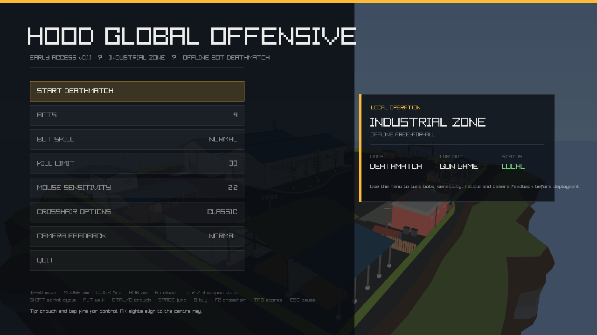
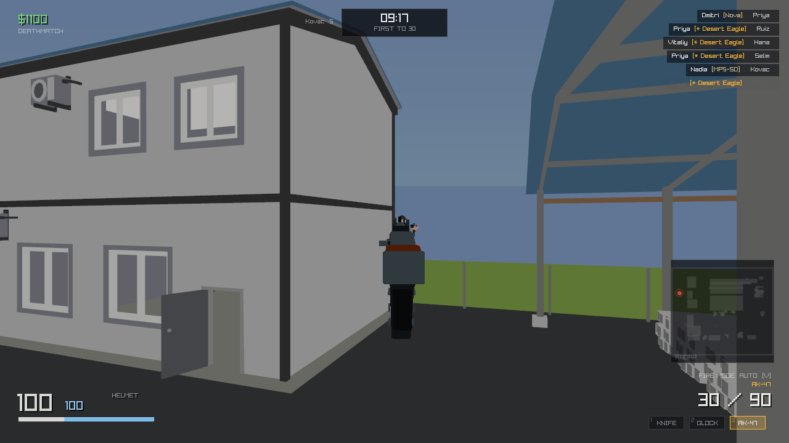
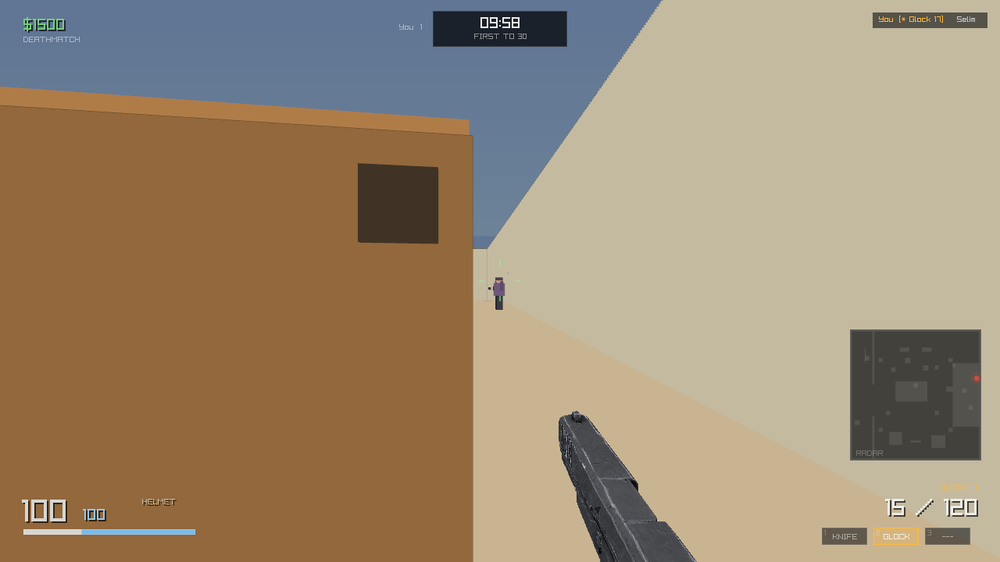
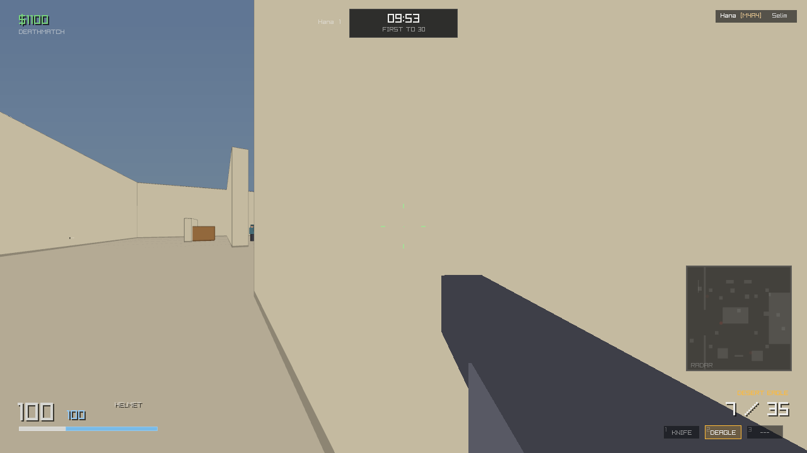
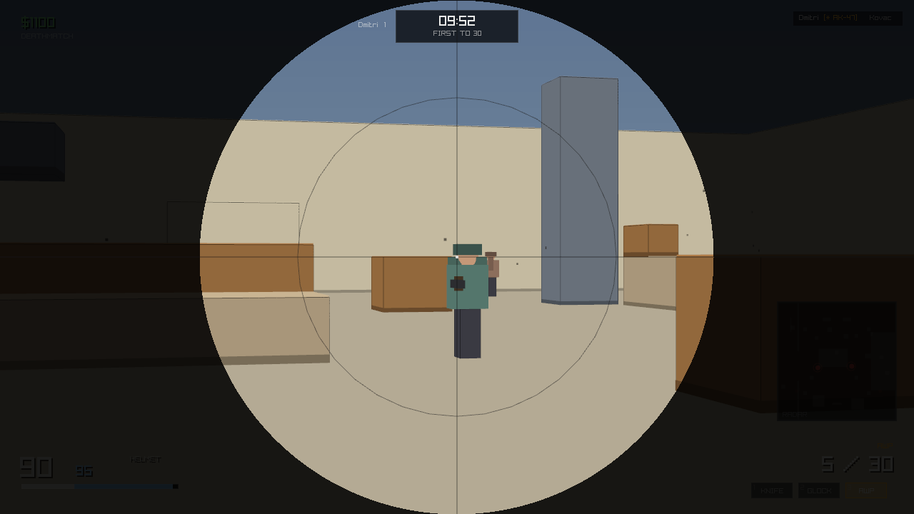
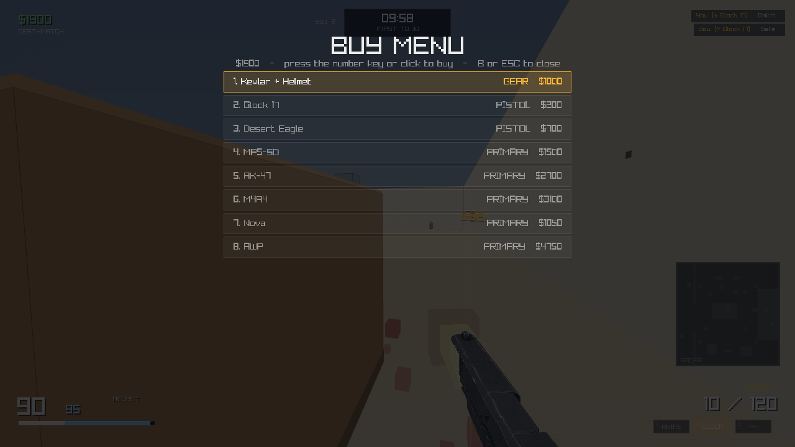
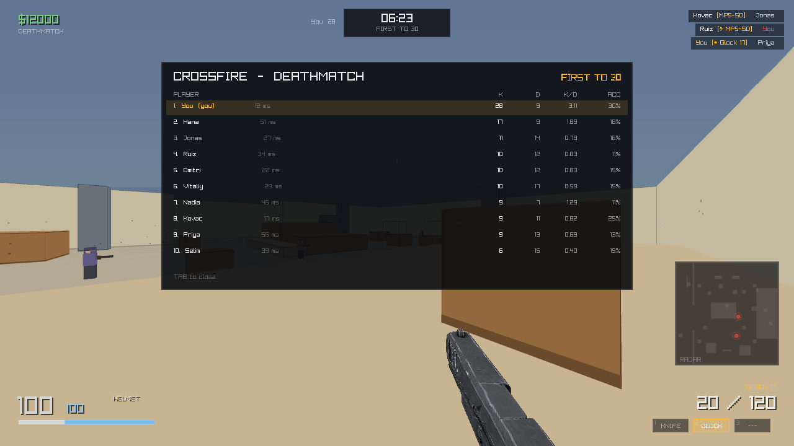

# HOOD GLOBAL OFFENSIVE

**A Counter-Strike style first-person shooter, written from scratch in C#.**

Free-for-all deathmatch against bots on a hand-built arena, with CS-derived movement physics,
hitscan gunplay with authored per-weapon spray patterns, a buy economy and a full first-person HUD.
No game engine: every sound effect is synthesised at startup, all level geometry is code, and the
single file the game reads from disk is one optimised weapon mesh.


> ### ⚠️ Early access
> This is **v0.1.0** — the game is complete enough to play a full match and have fun, but it is
> not finished. There is one map, one game mode, and no networking. See
> [Known issues](#known-issues) for the rough edges I already know about and
> [the roadmap](docs/ROADMAP.md) for where it is going.

---

## Screenshots







| | |
|---|---|
|  |  |
|  |  |

Every frame above is rendered by the real game rather than mocked up — see
[Verification](#verification) for how they are produced and checked. There is also a
[standalone gallery page](gallery.html).

---

## Quick start

**Requirements:** the [.NET SDK](https://dotnet.microsoft.com/download) 8.0 or newer
(this builds against `net10.0`), and a GPU/display to play. The only package dependency is
`Raylib-cs`, which ships native raylib binaries for Windows, Linux and macOS, so there is
nothing else to install.

```bash
git clone https://github.com/arjunsingh53/hood-global-offensive.git
cd hood-global-offensive
dotnet run
```

On Windows you can also just double-click **`play.cmd`**, which sets up the environment and then
launches the game. Arguments pass straight through: `play.cmd --headless --seconds 300`.

The first build takes a moment; after that the game starts immediately.

`dotnet run -- --help` lists every option:

```bash
dotnet run                                  # play
dotnet run -- --headless --seconds 300      # full match, no window, prints a report
dotnet run -- --screenshot shot.png         # render one gameplay frame to a PNG
```

---

## Controls

| Input | Action |
| --- | --- |
| `W` `A` `S` `D` | Move — Quake/CS acceleration, strafe-jumping works |
| Mouse | Aim |
| Left click | Fire |
| Right click | Toggle scope (**AWP only**) |
| `R` | Reload |
| `1` `2` `3` | Knife / pistol / primary |
| `Shift` | Walk (quiet, slower) |
| `Ctrl` | Crouch (smaller hitbox, tighter spread) |
| `Space` | Jump |
| `B` | Buy menu |
| `Tab` (hold) | Scoreboard |
| `Esc` | Pause |

---

## What is in the game

### Movement

A faithful port of the Quake/CS character controller: ground friction, run acceleration, a
30 unit/s air-acceleration cap (this is the thing that makes strafe-jumping work), 800 unit/s²
gravity, crouch that refuses to stand up under a low ceiling, and swept AABB collision with
automatic step-up onto ledges up to 20 units.

### Gunplay

Hitscan against separate head, chest, stomach and leg hitboxes. Damage falls off with distance,
headshots multiply per weapon, and thin penetrable cover can be shot through for reduced damage.

### Recoil and spray control

Recoil is an authored per-weapon spray pattern. The first bullet always flies true; recoil is
applied *after* the shot, kicks your actual view, and has to be dragged down and compensated by
the player — exactly like the real thing. It recovers on its own after a short delay, and the
pattern index resets if you stop firing long enough.

**Spread** is a cone that grows with movement speed, while airborne, and per-shot bloom, and
shrinks when crouched. The crosshair gap visualises it live.

### Weapons

| Weapon | Class | Price | Damage | Notes |
| --- | --- | --- | --- | --- |
| Knife | Melee | — | 55 | Very high kill reward ($1500) |
| Glock 17 | Pistol | $200 | 28 | Default sidearm, 20-round magazine; drawn from a real mesh |
| Desert Eagle | Pistol | $700 | 63 | Huge single-shot kick, 2.2s between shots |
| MP5-SD | SMG | $1500 | 27 | 750 RPM, cheap, accurate on the move |
| AK-47 | Rifle | $2700 | 36 | The signature 30-shot spray pattern |
| M4A4 | Rifle | $3100 | 33 | Flatter, more horizontal recoil |
| Nova | Shotgun | $1050 | 24 × 9 pellets | Devastating up close, 0.72 falloff |
| AWP | Sniper | $4750 | 115 | One-shot torso kill, 2-level penetration, scope |

Full damage model, hitbox multipliers and armour maths are documented in the
**[player guide](docs/GUIDE.md)**.

### Weapon meshes

Seven of the eight weapons are drawn from boxes: a few `DrawCubeV` calls posed in camera-local
space, which cost nothing and always frame correctly. The Glock 17 is drawn from an actual mesh
(`assets/weapons/glock17.glb`, 17,546 triangles) because the view model is the one piece of art the
player stares at for a whole match.

That file is generated, not committed as-is: the source asset was 145 MB (1,169,840 triangles and
an 8K albedo). `tools/build_weapon_asset.py` runs it through [gltfpack](https://github.com/zeux/meshoptimizer)
and re-encodes the embedded textures, which takes it to 2.7 MB. The same script documents the two
raylib constraints it works around — embedded textures must be PNG (raylib has no JPEG decoder, so a
JPEG-textured GLB loads as a 1×1 white texture) and gltfpack's UV quantization cannot be used (it
relies on `KHR_texture_transform`, which raylib ignores).

The placement is measured from the mesh at load time rather than hard-coded: the bounding box gives
the scale and centre, and the centroid of the front 2% of the mesh gives the bore line that the
muzzle flash hangs on. Re-export the asset and the framing follows.

### Bots

Bots perceive through a ~65° view cone plus a close-range "hearing" radius, gated by real
line-of-sight raycasts. They react after a difficulty-dependent delay, path with A* over a
895-node navigation graph sampled from the map geometry, strafe and hold range bands while
duelling, take cover when hurt, and compensate for their own accumulated recoil so their barrels
actually point at you. Four difficulty tiers vary reaction time, turn rate, aim error, burst
length and engagement range.

### Economy

Pure CS: starting money, per-kill rewards, and a buy menu for weapons and kevlar. You keep your
loadout through respawns.

### HUD

Crosshair with live spread, health/armour/ammo, money, a colour kill feed with headshot markers,
hitmarkers, floating damage numbers, directional damage indicators, a top-down radar that only
reveals enemies you can actually see, a held-`Tab` scoreboard with K/D and accuracy, a death
overlay with respawn countdown, and a low-health pulse.

### Audio

Every sound effect — gunshots, hits, headshots, footsteps, reloads, the buy blip, spawn and
match-end stingers — is synthesised to WAV at startup. The repository contains no binary audio
assets at all.

---

## Architecture

The project is split between a deterministic simulation and a presentation layer, which is what
makes headless testing possible.

```
Program.cs                     entry point: play / --headless / --screenshot
src/
  Core/
    Cfg.cs                     every gameplay constant in one table
    Util.cs                    math helpers + deterministic xorshift RNG
    Input.cs                   InputFrame, RealInput, ScriptedInput
    Game.cs                    window, state machine, frame loop
  World/
    Geometry.cs                AABB primitive with ray/box intersection
    GameMap.cs                 the "Crossfire" arena: brushes, spawns, world queries
    CharacterMover.cs          Quake-derived physics + swept collision + step-up
    NavGraph.cs                grid-sampled waypoint graph and A*
  Combat/
    Weapons.cs                 weapon definitions, spray patterns, runtime weapon state
    Hitscan.cs                 hitbox tests, damage falloff, armour, cover penetration
  Entities/
    Actor.cs                   shared state: hitboxes, health, armour, inventory, damage
    Player.cs                  view angles, weapon handling, view-model animation state
    Bot.cs                     perception, duelling behaviour, navigation, burst fire
  Sim/
    Simulation.cs              the authoritative world: combat, scoring, spawning, effects
    Effects.cs                 tracers, particles, decals, damage numbers, kill feed, sounds
    HeadlessRunner.cs          scripted-input match runner + the robot player
  Render/
    Renderer.cs                3D world, characters, effects, transformed view model
    WeaponModels.cs            loads and measures the art-mesh weapons
    ScreenshotCapture.cs       renders one real gameplay frame to a PNG
  UI/
    Ui.cs, Hud.cs, Screens.cs  immediate-mode drawing, HUD, menus, buy menu, scoreboard
  Audio/
    WavGen.cs                  procedural WAV synthesis
    AudioBank.cs               sound bank with distance attenuation
assets/
  weapons/glock17.glb          the one mesh the game loads (generated, see below)
tools/
  capture_shots.sh             regenerates every screenshot artifact in shots/
  build_weapon_asset.py        turns a source weapon model into the shipped asset
  inspect_png.py               dependency-free PNG inspector used to verify captures
  verify_shots.py              asserts view-model framing, scope mask and overlays
  sweep_weapons.py             checks all 8 view models at several moments each
```

[**docs/ARCHITECTURE.md**](docs/ARCHITECTURE.md) explains how the pieces fit together, including
the simulation/presentation split and the render-target trick that keeps the view model from
being clipped by walls.

---

## Verification

Nothing here is "it compiled, so it works".

### Headless simulation

`--headless` runs a complete match with a dictated robot player — no window, no GPU — and asserts
invariants. A representative run:

```
 simulated ticks      : 18000  (300.0s of 300.0s budget)
 wall clock           : 4985 ms  (3611 ticks/s)
 nav nodes            : 895
 map brushes          : 36
 player kills/deaths  : 29 / 10
 player accuracy      : 34.9%
 peak horizontal speed: 251 units/s  (run speed 250)
 respawns handled     : 152
 INVARIANTS
   ticks with player embedded in geometry : 0  (expect 0)
   frames with non-finite transforms      : 0  (expect 0)
   kills recorded == deaths recorded      : yes
   spawns are clear of geometry           : yes
 RESULT: PASS
```

This harness earned its keep: it caught that `Actor.Deaths` was never incremented, which would
have left the scoreboard showing zero deaths forever.

### Visual verification

`--screenshot` runs a match, waits until the player is alive with an enemy genuinely in view, then
renders a single real frame. `tools/inspect_png.py` decodes the PNG with the standard library and
measures where the view model and HUD actually land:

```
view model framing
  shots/01-ak47.png
    view model in lower-right :  23.9%  (want > 5)
    view model in centre      :   0.7%  (want < 6)
    view model in lower-left  :   0.4%  (want < 1)
    -> PASS
  shots/06-glock17.png
    view model in lower-right :  11.5%  (want > 5)
    view model in centre      :   0.7%  (want < 6)
    view model in lower-left  :   0.0%  (want < 1)
    -> PASS
title screen
  shots/00-menu.png
    accent top bar                     : 100.0%  (want > 80)
    title right-most pixel             :   762    (clear of the right edge)
    -> PASS
ARTIFACTS: ALL PASS
```

The box weapons are identified by their exact flat colours; the Glock 17's mesh is identified by
shape instead — dark, near-neutral pixels — because it is a photo texture. That family is capped
below the world's darkest flat surface and the checked regions stop short of the HUD's radar panel,
which is a similar grey. Measured on a control frame with the view model suppressed: **0.0%** inside
the checked regions, against 11.6% with it drawn, so the statistic can genuinely detect a weapon.

`tools/sweep_weapons.py` runs the same check across all eight weapons at five different moments
each, to catch animation states (reload dip, recoil, landing) that push the weapon where it should
not be:

```
weapon          min lower-right   max centre   max lower-left   verdict
Knife                     10.1%         2.4%             0.4%   PASS
Glock 17                   5.9%         2.2%             0.4%   PASS
Desert Eagle              29.6%         1.4%             0.4%   PASS
MP5-SD                    36.7%         0.7%             0.4%   PASS
AK-47                     25.2%         0.8%             0.3%   PASS
M4A4                      19.5%         1.9%             0.3%   PASS
Nova                      14.2%         1.2%             0.3%   PASS
AWP                       16.0%         2.1%             0.4%   PASS

WEAPON SWEEP: ALL PASS
```

These checks are not decoration — they caught the view model rendering as a thin sliver with its
muzzle sitting on the crosshair, a reload animation that swung the gun *up* into view instead of
dipping it, a world-clipping bug where standing near a wall made the weapon vanish entirely, and —
when the Glock 17 became a real mesh — a reload flourish tuned for the chunky box weapons that swung
the slim mesh almost out of frame (1.0% of the checked region mid-reload against 9.3% idle, 5.1%
after the fix below).

---

## Known issues

Honest list of things I know are wrong in v0.1.0:

- **`WeaponDef.ArmorPenetration` is defined per weapon but never read.** Armour is currently a flat
  model (see [the guide](docs/GUIDE.md#armour)) rather than CS's per-weapon armour ratio. The
  numbers are in the table, the logic is not wired up yet. Tracked in the roadmap.
- **Armour is free and granted on every respawn**, which makes the $1000 "Kevlar + Helmet" buy
  option redundant. The economy around armour needs a design pass.
- **No sound-occlusion or wall-bang audio** — you can hear a gunfight through three walls.
- **Bots do not use grenades** (there are no grenades yet) and never buy, they are given loadouts.
- **No networking, one map, one mode.** Deathmatch only.
- **No config file** — options are set in the main menu per session and are not persisted, and
  keys are not rebindable.

---

## Roadmap

Short version: fix the armour model, add a second map, add grenades, add persistence for settings,
then consider team modes. The full list with reasoning is in
[**docs/ROADMAP.md**](docs/ROADMAP.md).

---

## Tuning

Almost everything that affects feel lives in [`src/Core/Cfg.cs`](src/Core/Cfg.cs): gravity, run
speed, air acceleration, friction, jump velocity, respawn delay, kill limit, match length,
sensitivity. Per-weapon numbers — including the 30-entry recoil patterns — are in
[`src/Combat/Weapons.cs`](src/Combat/Weapons.cs).

The map is defined as data in [`src/World/GameMap.cs`](src/World/GameMap.cs); adding a brush is one
`Add(...)` call and the navigation graph rebuilds itself from the geometry at startup.

---

## Documentation

| Document | What it covers |
| --- | --- |
| [**docs/GUIDE.md**](docs/GUIDE.md) | The full player guide: movement tech, damage and armour maths, spray control, economy, bot behaviour, map layout, tactics, troubleshooting |
| [docs/ARCHITECTURE.md](docs/ARCHITECTURE.md) | How the code is organised and why |
| [docs/BUILDING.md](docs/BUILDING.md) | Building, publishing, running the test tooling |
| [docs/ROADMAP.md](docs/ROADMAP.md) | Planned work |
| [CHANGELOG.md](CHANGELOG.md) | Version history |
| [CONTRIBUTING.md](CONTRIBUTING.md) | How to contribute |

---

## Contributing

Issues and pull requests are welcome. Please read [CONTRIBUTING.md](CONTRIBUTING.md) first — the
short version is: keep the simulation and presentation layers separated, put tunable numbers in
`Cfg.cs`, and make sure `dotnet run -- --headless` still passes before opening a PR.

---

## License

MIT — see [LICENSE](LICENSE).

**Hood Global Offensive is an unofficial fan project.** It is not affiliated with, endorsed by, or
connected to Valve Corporation. *Counter-Strike* and *Global Offensive* are trademarks of Valve.
This is an independent implementation written from scratch in C#; it contains no Valve code or
assets.
